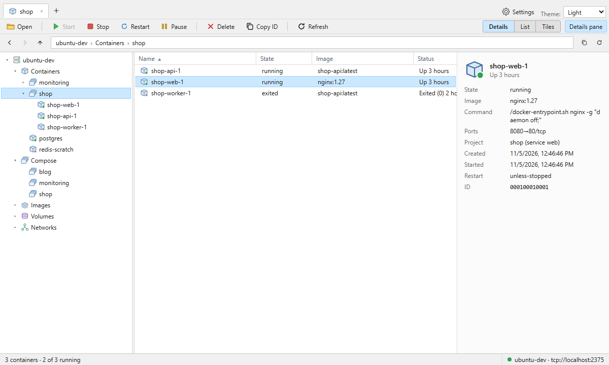
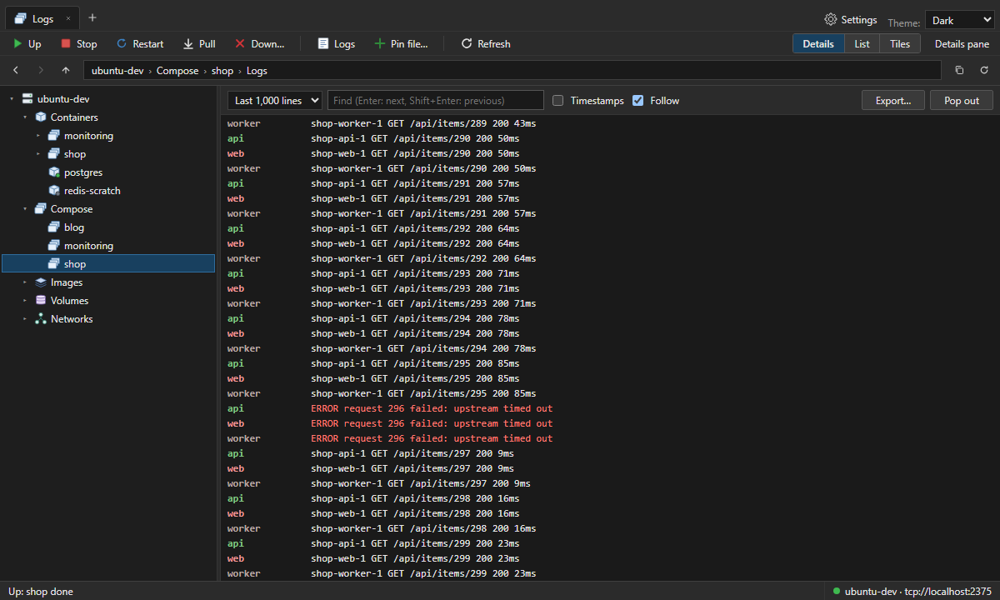
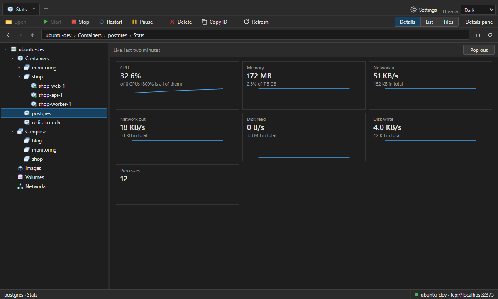
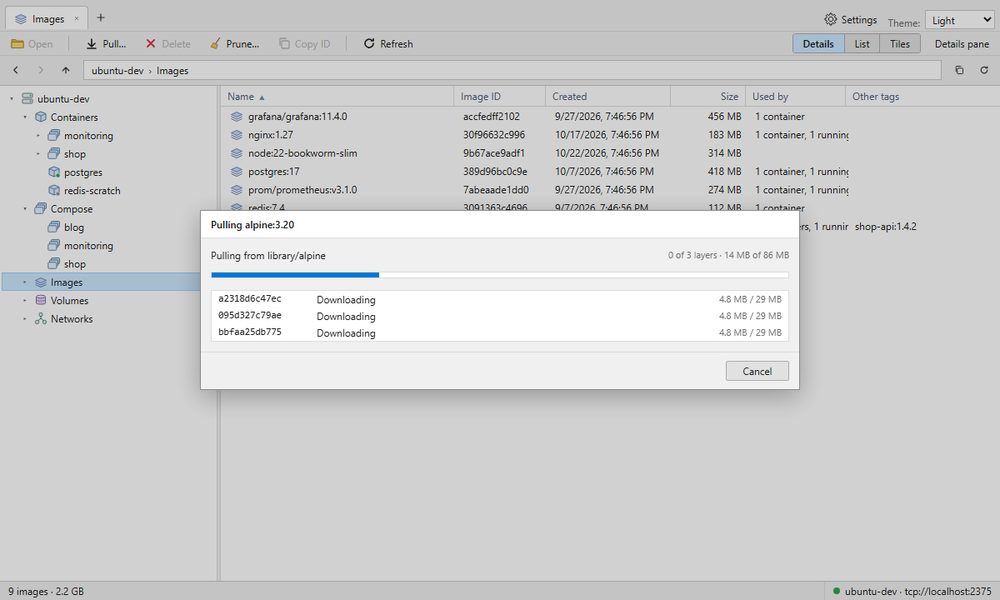
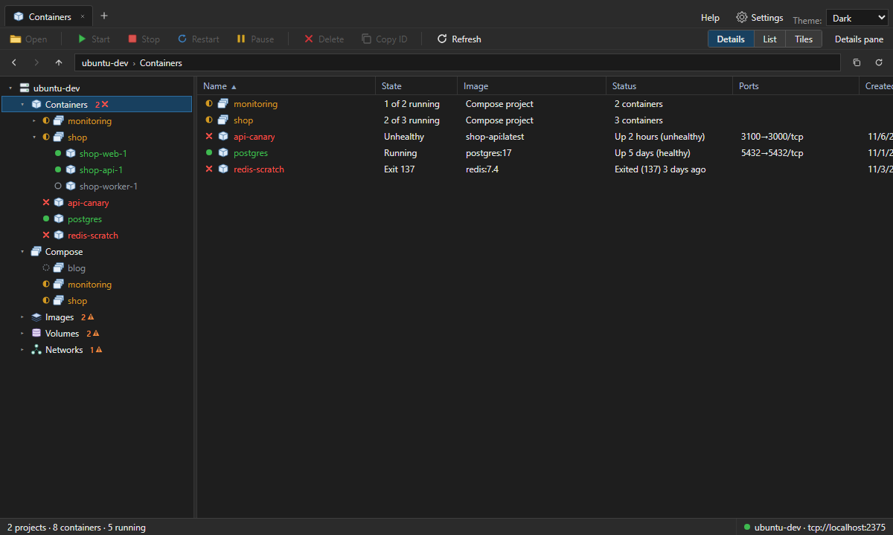

# Docker Control Centre

A Windows desktop app for managing a Docker engine the way File Explorer
manages files: tabs, a tree, an address bar you can type into, and compose
projects, containers, images, volumes and networks as folders. Built for
Docker Engine running in WSL (no Docker Desktop needed). Tauri 2, React and
Rust.



## Features

- **Containers:** compose projects and standalone containers. Start, stop,
  restart, pause, kill and delete them (a project stands for all of its
  containers). Open a container for:
  - **Logs:** live tail, search, timestamps, time ranges, export.
  - **Terminal:** bash or sh inside the container.
  - **Stats:** CPU, memory, network, disk and processes, live.
  - **Files:** browse its folders (even in images with no shell, or stopped
    containers), copy files out, copy files or folders in, or drag them in
    from Explorer.
  - **Environment, mounts, ports, networks, labels.**

  Logs, terminal and stats can pop out into their own windows.
- **Compose:** running projects, plus compose files you pin so a project
  stays listed while it's down. Up, stop, restart, pull and down (deleting
  volumes needs the project name typed), with compose's output as it runs,
  and every service's logs merged in time order. Each project's Compose
  file shows the files it was started from (read-only, one tab each, with
  Show in folder and Open in editor) and, on request, the resolved config.
- **Images:** pull with per-layer progress, inspect (config, history, which
  containers use it), delete, and prune with a preview of exactly what goes.
- **Volumes:** which containers use each, delete (type the name to confirm:
  the data is gone for good), prune unused or only anonymous volumes.
- **Networks:** subnets, attached containers, delete and prune; Docker's own
  networks are left alone.

Everything is colour-coded by state, with a distinct mark per state so it
doesn't rely on colour alone: green running or in use, amber starting,
paused or partly running, red for a crash or failing health check, blue idle
(only stopped containers use it), grey stopped or unused, orange orphaned
(safe to prune). The tree counts problems and orphans per section, and
**Help › What the colours mean** explains each one.

The tree shows only what's live by default: running containers, anything
with a problem, and what running containers use. **Show:** above the tree
relaxes it to *Running and stopped* or *Everything*, and each branch ends
with a "+ n more" row that reveals the rest of that branch. Lists in the main
pane always show everything.

Lists update live from the engine's events. Tabs, the view for each place,
the details pane and the window's size and position come back next time.

| | |
|---|---|
|  |  |
| Every service's logs, merged | Live stats |
|  |  |
| Pulling an image | Status colours: crashed, unhealthy, partly running |

## Install

Download the installer from the
[latest release](../../releases/latest) (`…_x64-setup.exe`, or the `.msi`
for managed deployment). Builds aren't code-signed yet, so Windows
SmartScreen warns on first run: **More info**, then **Run anyway**.

## Connecting to Docker

The app uses `DOCKER_HOST` when it's set (`tcp://`, `npipe://` or `unix://`),
and `tcp://localhost:2375` otherwise. That default suits Docker Engine in WSL
with its API published on localhost: **[docs/WSL-SETUP.md](docs/WSL-SETUP.md)**
walks through setting that up.

**Security:** port 2375 is the Docker API with no authentication. Anyone who
can reach it controls the engine and, through it, the machine. Only bind it to
`localhost`, never to `0.0.0.0`.

### Compose and WSL

With Docker Engine in WSL, `docker compose` has to run inside WSL: the engine
resolves bind-mount paths on the Linux side. By default the app runs
`wsl.exe [-d <distro>] --cd <project folder> -- docker compose …`, converting
Windows paths (`E:\projects\shop` becomes `/mnt/e/projects/shop`). Choose the
distro, or switch to running compose on this computer (Docker Desktop), in
**Settings**; **Test** runs `docker compose version` the same way.

## Keyboard shortcuts

| Keys | Action |
|---|---|
| Enter / double-click | Open |
| Backspace, Alt+↑ | Up one level |
| Alt+← / Alt+→ | Back / forward |
| F5 | Refresh |
| Ctrl+A | Select all |
| Ctrl+T / Ctrl+W | New tab / close tab |
| Ctrl+Tab / Ctrl+Shift+Tab | Next / previous tab |
| Ctrl+L, Alt+D | Type an address (e.g. `/containers/@shop/shop-web-1`) |
| Middle-click a tab | Close it |
| Del | Delete the selected items (asks first) |
| Ctrl+Shift+5 / 6 / 7 | List / details / tiles view |
| Alt+Shift+P | Show or hide the details pane |

In a terminal, the shell gets every key (Ctrl+W, Ctrl+L, …).

## Development

See `CLAUDE.md` for the architecture, the rules and how to add a section,
`PLAN.md` for the decisions behind it, and `CHANGELOG.md` for what changed.

### Prerequisites

- Node.js 20+ (LTS)
- Rust (stable, MSVC toolchain on Windows) + Microsoft C++ Build Tools
- WebView2: already part of Windows 10/11

### Run

```
npm install
npm run tauri dev
```

The first build compiles the Rust dependencies and takes a few minutes; later
builds are incremental.

### Test

```
npm test                                          # Vitest unit tests
npm run ui:check -- --both                        # UI scenarios, both themes (Playwright, IPC mocked)
cd src-tauri && cargo test                        # Rust unit tests
cd src-tauri && cargo test --features integration # against a real engine (and WSL)
```

`ui:check` runs `tools/ui-check/scenarios` against the Vite dev server with
the Tauri IPC mocked by `tools/ui-check/mock-ipc.js`, saving screenshots to
`tools/ui-check/out/`; it fails on console errors or commands with no mock.
It needs Chromium once: `npx playwright install chromium`. The integration
tests create and remove throwaway `dcc-…` containers, volumes and networks,
and use `python:3.12-slim` when it's already on the engine.

### Release

1. Raise `version` in `package.json`, `src-tauri/Cargo.toml` and
   `src-tauri/tauri.conf.json`; `npm run version:check` confirms they match.
2. Run `cargo audit` in `src-tauri`, and update `CHANGELOG.md`.
3. Push a tag: `git tag v0.1.0 && git push origin v0.1.0`. The **Release**
   workflow checks the tag matches, runs the tests, and builds the Windows
   installers (macOS and Linux on a best-effort basis) into a draft release.
4. Check the draft on GitHub and publish it.

To build locally instead: `npm run tauri build` (outputs under
`src-tauri\target\release\bundle\`; `-- --bundles nsis` for just the setup
program).

## Licence

Dual-licensed under [MIT](LICENSE-MIT) or [Apache-2.0](LICENSE-APACHE), at
your option.
